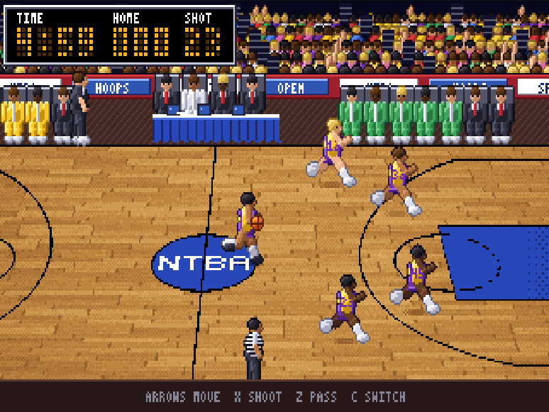
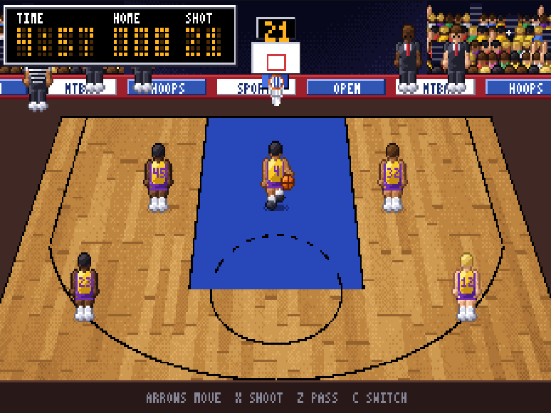

# NtBA — Not the Basketball Association

An open-source, five-on-five basketball game in faithful late-1980s / early-1990s pixel art.
Rust compiled to WebAssembly, played in the browser. Independent project — no affiliation with any
real league; no real teams or players.

## Inspiration

| Game | What we take from it |
| --- | --- |
| *Lakers versus Celtics and the NBA Playoffs* (Electronic Arts, 1989) | The genre anchor: pace, rules and a televised-game feel — lineup introductions, halftime show |
| *TV Sports: Basketball* (Cinemaware, 1990) | The graphics fidelity we are after, and its **camera views**: a side view for the backcourt and an end-on view for half-court play. Also on the wishlist: its create-a-player mode, presenter and mock commercials |
| A slightly later EA basketball game | The floor, sprite and scoreboard look (subtle planks, large animated players, compact HUD) |

Our art and content are original; see [context/](context/) for the reference notes.

**Art status — procedural today, sprites later.** Everything you see (players, crowd, hoop,
floor) is currently *generated by code* with shaded shapes, ramps and outlines; there are no
hand-drawn sprite sheets yet. That is a stand-in: the plan is to replace it with hand-authored
pixel-art sprite sheets in the same palette ([roadmap](docs/ROADMAP.md)).

**Period constraints, on purpose:** 320x200 (displayed at 4:3), a palette of at most 256 colours
(we use under 100, in hand-built shading ramps), dithered lighting, and no blending — see
[docs/ARCHITECTURE.md](docs/ARCHITECTURE.md).

**Status: proof of concept.** One team, no defence: run, pass, shoot, score against a shot clock
and a 5-minute game clock. See [docs/VISION.md](docs/VISION.md) for where this is headed and
[docs/ROADMAP.md](docs/ROADMAP.md) for milestones and the wishlist (opposing bot team, online
peer-to-peer play, a native build, create-a-player, and — far in the future — TV presentation).




## Play it

```sh
nix develop        # or install Rust via rustup; rust-toolchain.toml pins everything
make serve         # builds the wasm and serves http://localhost:8080
```

Open http://localhost:8080 and click the page if keys don't respond.

| Key | Action |
| --- | --- |
| Arrows / WASD | Move the highlighted player (on the end-on half-court view, Up runs toward the basket) |
| `X` / `K` | Shoot (3 pts from beyond the arc; farther shots miss more often) |
| `Z` / `J` | Pass to the teammate in the direction you hold (nearest if none) |
| `C` / Space | Switch player while the ball is loose |
| Enter | Restart after the final buzzer |

Without Nix: `rustup show && make serve` (needs Python 3 and `make`).

## Repository layout

| Path | Contents |
| --- | --- |
| `crates/ntba-core` | Simulation, rules and software pixel renderer (platform independent) |
| `crates/ntba-wasm` | WebAssembly build exposing the core through a small C ABI |
| `web/` | Static page: canvas, keyboard, fixed 60 Hz tick loop |
| `docs/` | [Vision](docs/VISION.md), [roadmap and wishlist](docs/ROADMAP.md) and [architecture](docs/ARCHITECTURE.md) |
| `context/` | Links and notes about the 1989 original |
| `flake.nix`, `rust-toolchain.toml` | Reproducible dev shell / pinned toolchain |

## Contributing

Read [CONTRIBUTING.md](CONTRIBUTING.md); `make check` must pass. Every asset must be original —
nothing copied from commercial games.

## License

GPL-3.0-or-later. See [LICENSE](LICENSE).
