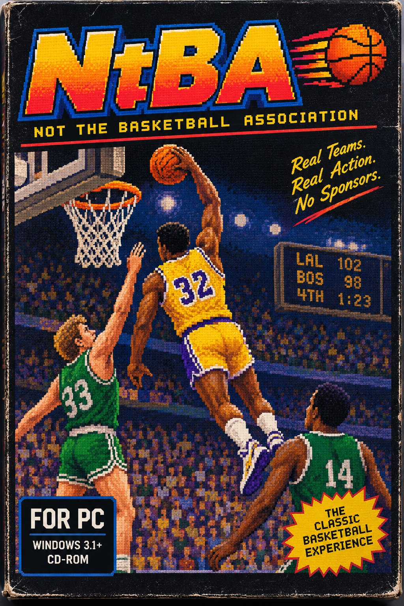
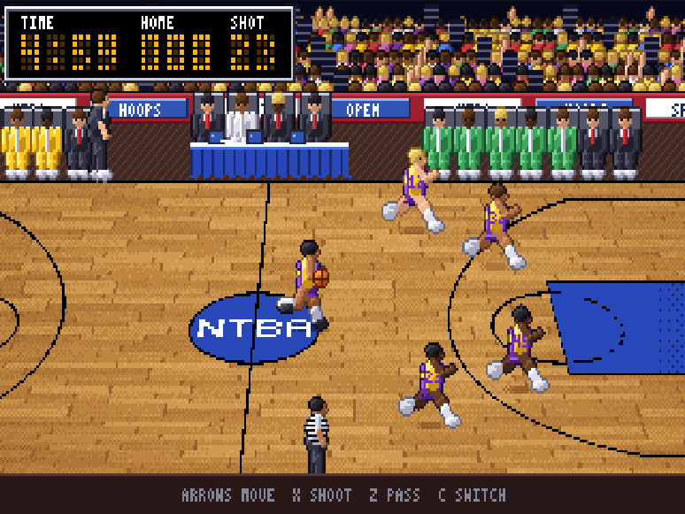
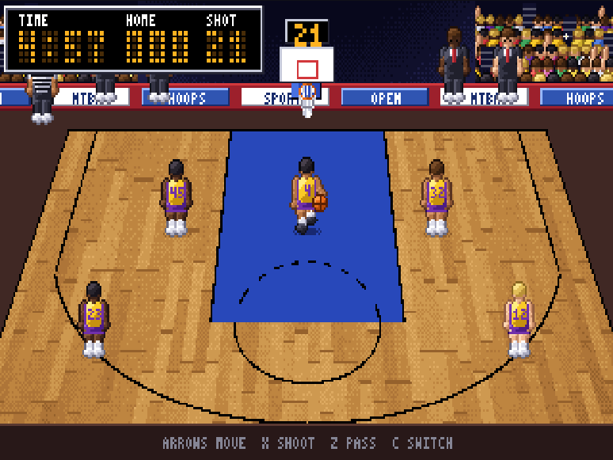

<h1 align="center">🏀 NtBA</h1>
<p align="center"><b>Not the Basketball Association</b></p>

<p align="center">
  
</p>

<p align="center">
  <i>Remember when sports games came in a big cardboard box, and the court was made of chunky pixels? Yeah. We missed that too.</i>
</p>

<p align="center">
  <a href="https://eyalro.github.io/NtBA/"></a>
  &nbsp;
  <a href="https://github.com/EyalRo/NtBA/wiki"></a>
</p>

---

## 🕹️ Play it right now

### 👉 **[eyalro.github.io/NtBA](https://eyalro.github.io/NtBA/)** 👈

NtBA is an open-source basketball game in the spirit of the late-80s home-computer classics.
<p align="center">
  
  
</p>
<p align="center"><sub>Sideline view for the fast break, end-on view when you attack the hoop.</sub></p>

## 🤖 Play the computer
1. Choose **VS CPU**.
2. Pick a level (**Novice**, **Pro** or **All-Star**) and your side (**Home** or **Away**).
3. Press **Start**. Both key sets steer your player.

## 🌐 Play a friend online
1. Choose **Online**.
2. Press **Challenge** next to a player. They get 30 seconds to **Accept** or **Decline**.
3. Accepted? Tip-off.

## 🎮 Controls

| Home (gold) | Away (green) | Action |
| --- | --- | --- |
| **WASD** | Arrow keys | Run |
| **X** | **K** | Shoot (on defense: swipe for a steal or jump to block) |
| **Z** | **J** | Pass (hold a direction to pick your target) |
| **C** | **L** | Switch to the teammate nearest the ball |
| **M** | **M** | Sound on / off |
| **B** | **B** | Colour-blind mode on / off (away team wears blue instead of green) |

Run into the ball handler to strip the ball. Against the CPU or online, you control one team and either key set works. Sound starts off; turn it on with **M** or the Sound button under the screen at any time.

## ✨ What's in the box

- 🏀 Five-on-five against the computer, on one keyboard or across two computers
- 🤖 A CPU opponent at three levels: Novice, Pro and All-Star
- 🛡️ Real defense: strips, steals, blocks, jumped passing lanes
- 🎥 Two camera angles that switch with the action
- 🎯 Risk/reward shooting: long shots are riskier, threes are worth the gamble
- 🏟️ Crowd, benches, refs and a glowing scoreboard
- 🔊 C64-style chip sound effects (off until you turn them on)

> **Early days.** It's a playable prototype.

## 🛠️ Build it yourself

Rust compiled to WebAssembly, with a plain JS front end (no framework, no bundler).

```sh
make serve   # builds web/ntba.wasm and serves http://localhost:8080
make check   # fmt, clippy, tests, wasm build: everything CI runs
```

You'll need a Rust toolchain (`rustup` picks up the pinned one and the `wasm32` target
automatically) and Python 3 for the tiny dev server. There's also a `flake.nix` if you're a Nix person.

## 🤖 Work on NtBA with an AI agent

Not sure how to help? Every open [issue](https://github.com/EyalRo/NtBA/issues) is sized for one pull
request, so you can hand one to an AI coding agent. If you don't know where to start, paste this prompt into your agent:

````text
You are helping with NtBA ("Not the Basketball Association"), an open-source retro basketball game
written in Rust (compiled to WebAssembly) with a plain JavaScript front end.
Repository: https://github.com/EyalRo/NtBA

1. Read README.md, wiki/Architecture.md, and wiki/Online-Play.md before touching code.
2. Pick ONE open issue from https://github.com/EyalRo/NtBA/issues. Each is sized for a single pull
   request. Issues titled "Tracking: ..." are lists, not tasks: open them and take one of the
   issues they link. Prefer the label "good first issue", and skip any issue whose "Depends on"
   issues are still open. If I tell you my interest (game rules, bot AI, web UI, graphics, sound,
   networking), pick from that area. Say which issue you picked and why before you start.
3. Work on a new branch and change only what that issue asks for. Its "Out of scope" section is a
   hard limit.
4. Follow these project rules:
   - Determinism: the simulation must give bit-identical results on every machine. In
     crates/ntba-core/src/game.rs, use only + - * / and sqrt on f32, never read a clock, and use only
     the seeded RNG already in Game. Anything that affects the simulation goes into
     Game::state_hash(). If a change legitimately alters the pinned cross-build hash in
     crates/ntba-core/src/replay.rs, re-pin it and explain why in the PR.
   - ntba-core has no dependencies. Keep it that way.
   - Art, sound, and text must be original. Never copy or trace commercial games, and use only
     fictional teams and players.
   - Never commit secrets or credentials.
   - Documentation lives in wiki/ (it is published to the GitHub wiki). Don't add new markdown files
     elsewhere.
   - Don't change the wire protocol or the wasm exports unless the issue says to; if you must,
     say so clearly in the PR.
5. Before opening the PR, run `make check`. If you touched crates/ntba-core, ntba-net or ntba-wasm,
   also run `make determinism`; for signaling changes run `cd signaling && npm test`.
   Report the real results. If something fails, say so and why; don't hide it.
6. Open a pull request whose description starts with "Closes #<issue number>", lists what you
   verified, and includes screenshots for anything visual. Keep it small and focused.

If something is unclear, ask me one short question instead of guessing.
````

## 🗺️ Where to go from here
- 📖 **[Wiki](https://github.com/EyalRo/NtBA/wiki)**: how to play, vision, architecture, roadmap
- 🐛 **[Issues](https://github.com/EyalRo/NtBA/issues)**: bugs, ideas, and everything planned
---

<p align="center"><sub>
NtBA is an independent fan project, not affiliated with or endorsed by any league, team, or player.<br>
Released under the <a href="LICENSE">GPL-3.0-or-later</a>. Go sink one. 🏀
</sub></p>
