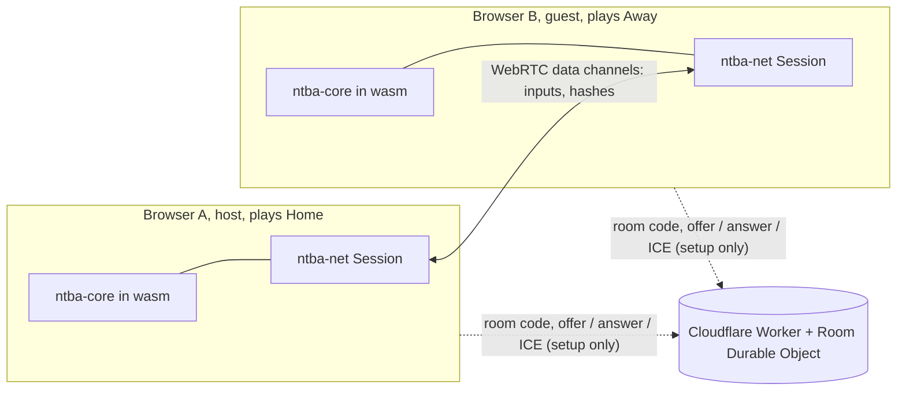

# Online play (peer-to-peer)

Two people play each other over the internet with **no game server**. The only infrastructure
is a tiny signalling service that helps the two browsers find each other; once connected, the
players talk directly and the service is out of the loop.

Tracking issue: [#9](https://github.com/EyalRo/NtBA/issues/9). Implementation steps:
[#40](https://github.com/EyalRo/NtBA/issues/40) design (this page),
[#41](https://github.com/EyalRo/NtBA/issues/41) state hash and replay,
[#42](https://github.com/EyalRo/NtBA/issues/42) wire protocol and transport,
[#43](https://github.com/EyalRo/NtBA/issues/43) lock-step session,
[#44](https://github.com/EyalRo/NtBA/issues/44) signalling service,
[#45](https://github.com/EyalRo/NtBA/issues/45) WebRTC and lobby,
[#46](https://github.com/EyalRo/NtBA/issues/46) desync and disconnect handling.

## Decisions at a glance

| Question | Decision |
| --- | --- |
| Sync model | **Deterministic delay-based lock-step**: peers exchange *inputs* (one byte per team per tick), never game state. |
| Transport | **WebRTC data channels**: one reliable and ordered, one unreliable and unordered. |
| Finding each other | Cloudflare Worker + **one Durable Object per room**, 6-character room codes. |
| NAT traversal | **STUN** (Cloudflare, free) always; **TURN** is optional and off until the operator adds credentials. |
| Authority | None needed: both peers simulate the same game and check each other with state hashes. |
| Desync | State hash every 60 ticks; a mismatch stops the match with an explanation. |
| Versioning | The `Hello` message carries the protocol version and a **build id** (a hash of the simulation's behaviour); mismatches refuse to play. |
| Disconnects | Distinct outcomes for quit, lost connection, timeout (5 s of silence), desync and version mismatch. No reconnect yet. |

## Why lock-step and not host-authoritative snapshots

Two designs were considered:

1. **Host-authoritative:** the host runs the game and streams positions and the ball to the
   guest, who interpolates. It needs a snapshot format for every part of the game, interpolation,
   client-side prediction to hide a full round trip of input lag, and more bandwidth. The host can
   also cheat, and the match dies with the host.
2. **Lock-step (chosen):** the core was *already built for this*. The simulation is fixed-step
   (60 Hz), never reads a clock, takes input as one byte per team per tick, uses a seeded RNG and
   sticks to `+ - * /` and `sqrt` on `f32` in `game.rs` so results are bit-identical on every
   machine. So both peers just run the same game and swap input bytes: a few bytes per tick, no
   snapshot or interpolation code, no host advantage, and the same input log doubles as a replay.

The price of lock-step is **input delay** (your own input is applied a few ticks after you
press it, currently 6 ticks = 100 ms, so it can cross the network in time) and the need for
*exact* determinism, which is why every online match checks state hashes. Rollback (apply input
immediately, rewind when the remote input differs) is a possible later upgrade; the wire
protocol would not change.

## Architecture



| Piece | Where | Role |
| --- | --- | --- |
| `ntba-core` | `crates/ntba-core` | The deterministic simulation. Adds `Game::state_hash()` and `replay::InputLog`. |
| `ntba-net` | `crates/ntba-net` | Wire protocol, `Transport` trait, simulated `LocalLink`, lock-step `Session`, level-based logging. No browser or OS dependency, so a native client can reuse it. |
| `ntba-wasm` | `crates/ntba-wasm/src/net.rs` | C-ABI glue: JavaScript hands received bytes in and drains bytes to send. No wasm imports needed. |
| `web/net.js` | `web/` | Signalling client and the `RTCPeerConnection` with its two data channels. Moves bytes only. |
| `web/main.js` | `web/` | Lobby UI and the same fixed-timestep loop, driving the session instead of the solo game. |
| `signaling/` | repo root | The Cloudflare Worker and `Room` Durable Object. |

## The lock-step session

* The **host** picks the seed and the input delay and plays Home; the **guest** adopts both from
  the host's `Hello` and plays Away.
* Each frame the session samples the local pad **only when it needs a new input** (so a stall never
  silently increases the delay), appends it to a queue `delay` ticks ahead, and sends **every input
  byte the peer has not acknowledged yet** (oldest first, up to 128) on the unreliable channel. A lost
  packet is therefore repaired by the next one, with no retransmission delay.
* A tick runs only when both pads for it are known. If the peer's byte is missing the session
  **stalls** rather than guessing; the web loop does not accumulate a catch-up burst while stalled.
* After every 60 ticks both peers send a hash of the full game state; a mismatch sends `Bye(Desync)`
  and ends both sides with the tick and both hashes in the log.
* `Ping`/`Pong` every 30 frames measure round-trip time (shown as "ping" in the page).
* The session records every simulated tick, so an online match can be exported as an `InputLog` and
  replayed offline.

### Messages

All messages are `tag: u8` plus fixed little-endian fields. Decoding is strict (unknown tags,
truncation, trailing bytes, bad values and oversized input runs are errors, never panics), because
the bytes come from another machine.

| Message | Channel | Purpose |
| --- | --- | --- |
| `Hello { protocol, build, seed, side, input_delay }` | reliable | First message each way; version check, seed and delay from the host. |
| `Inputs { ack, first_tick, pads[] }` | unreliable | Redundant window of the sender's pad bytes plus an acknowledgement. |
| `Hash { tick, hash }` | reliable | State hash after `tick` ticks. |
| `Ping`/`Pong { id }` | unreliable | Round-trip time and liveness. |
| `Bye { reason }` | reliable | Quit, desync or version mismatch. |

## Connection flow

1. The host calls `POST /rooms` and gets a code such as `K7M2QX` (valid for 10 minutes), opens the
   room WebSocket as `host`, and shows the code.
2. The guest enters the code and opens the WebSocket as `guest`. The room tells the host
   `peer-joined`.
3. The host creates a WebRTC offer; offer, answer and ICE candidates travel through the room.
4. Both data channels are **pre-negotiated** (ids 0 and 1), so there is no `ondatachannel` step.
   When both open, each side sends `done` and the room closes; the match starts with `Hello`.
5. If no direct path forms within 25 s (or the browser reports `failed`), the page says it could
   not connect directly and offers to try again.

### Data channels

| Channel | Settings | Carries |
| --- | --- | --- |
| `reliable` (id 0) | ordered, retransmitted | `Hello`, `Hash`, `Bye` |
| `fast` (id 1) | unordered, `maxRetransmits: 0` | `Inputs`, `Ping`, `Pong` |

One reliable channel for everything would let a single lost packet stall all later inputs
(head-of-line blocking). Inputs are sent as a repeating window instead.

## The signalling service

Source, security model and operator notes: [Signalling Service](Signaling-Service).

| Route | Purpose |
| --- | --- |
| `POST /rooms` | Create a room: `{ code, ttl }` |
| `GET /rooms/<code>/ws?role=host\|guest` | WebSocket into the room's Durable Object |
| `GET /ice` | `{ iceServers }`: STUN, plus short-lived TURN credentials when configured |
| `GET /health` | Liveness |

* **Why a Durable Object per room, not a plain stateless Worker.** Two requests for the same room
  can be handled by *different isolates*, which do not share memory, so an in-memory room table
  would randomly say "room not found". A Durable Object is a single addressable instance per room
  and is available on the Workers Free plan (SQLite-backed).
* The room holds at most one `host` and one `guest` socket, relays `offer`, `answer` and `ice`
  verbatim, rejects anything else, caps messages at 8 KiB and 100 per socket, and deletes itself
  after `ROOM_TTL_SECONDS` (default 600) or when a peer sends `done`.
* Other protections: an `ALLOWED_ORIGINS` allow-list, a per-IP Workers rate-limit binding, bias-free
  room codes from an alphabet without look-alike characters.
* **Privacy:** nothing about players is stored; signalling payloads and IP addresses are never logged.
  (As with any WebRTC game, the two players do learn each other's IP address.)
* The service never sees gameplay.

## NAT traversal, STUN and TURN

Direct connections cannot be guaranteed between every pair of networks (symmetric NAT, some
mobile carriers, strict firewalls). The page uses Cloudflare's STUN service
(`stun.cloudflare.com`, free) for every game. For the pairs that still cannot connect, a **TURN
relay** is supported but **off by default**: set `TURN_KEY_ID` and `TURN_KEY_API_TOKEN` as Worker
secrets (never in the repo) and `/ice` starts returning short-lived TURN credentials.

Per Cloudflare's documentation (checked October 2026) STUN is free and unlimited, and TURN is
$0.05 per GB sent from Cloudflare with a monthly free allowance of 1,000 GB shared with Cloudflare's
other real-time services. An NtBA match sends on the order of 1 to 2 KB per second, so the free
allowance would go a very long way; the first version still defaults to *no relay* so that nothing
quietly turns into a bandwidth-bearing server. Check Cloudflare's current pricing before enabling it.

## Determinism

* `Game::state_hash()` is a 64-bit FNV-1a over every field that affects the simulation (floats by
  bit pattern), so any divergence shows up.
* `replay::InputLog` records a seed and the pads for each tick and can replay them.
* A **golden hash** (`DETERMINISM_SEED_HASH` in `ntba-core`) pins the result of replaying a fixed
  synthetic 3,600-tick script. A native unit test checks it, and `scripts/check-determinism.mjs`
  runs the *built wasm* in Node and checks it too; both are in CI. Native and wasm currently agree.
* The golden hash is also the **build id** peers compare in `Hello`: if you change simulation
  behaviour on purpose, update the constant and peers on the old version will refuse to match.
* A changed input can legitimately converge back to the same state a few hundred ticks later (a
  player pinned against the boundary, a possession reset), so tests compare hashes at the tick of
  the change, not just at the end.

## Failure handling

| Outcome | What the player sees |
| --- | --- |
| Other player pressed Leave | "The other player left the match." |
| You pressed Leave | "You left the online match." |
| Hash mismatch | "The two games went out of sync, so the match was stopped." |
| Different protocol or build | "…running a different version of the game. Reload both pages and try again." |
| Transport closed or failed | "The connection to the other player was lost." |
| 5 s of silence | "The other player stopped responding." |
| Invalid data from the peer | "The other player sent something unexpected…" |
| No direct path at setup | "Couldn't connect directly… try again, or try a different network." |

While the peer's input is late the match simply pauses (stalls) until it arrives.

## Logging

All layers use the standard levels DEBUG, INFO, WARN and ERROR. The Rust net layer has no I/O of its
own: the host installs a sink (the page forwards to `console.debug/info/warn/error`). The Worker writes
one JSON object per line with a `level` field.

## Verification

| Check | Where |
| --- | --- |
| Replay and state hash behaviour, golden hash | `ntba-core` tests |
| Native and wasm simulate bit-identically | `scripts/check-determinism.mjs` (CI) |
| Protocol round trips, truncation and garbage rejection | `ntba-net` tests |
| Lock-step in sync over latency, jitter and 25% loss; stall behaviour; desync detection; version refusal; quit, sever, timeout | `ntba-net` session tests over the simulated link |
| Two wasm instances over a lossy link end on the same tick with the same hash | `scripts/test-net-wasm.mjs` (CI) |
| Signalling logic, room object and Worker routes | `signaling` unit tests (CI), with fake sockets |
| Real Durable Object, real WebSockets | `signaling` end-to-end script against `wrangler dev` |
| Two real Chromium pages, real WebRTC, real signalling server | manual run (sides, seed, ping, same tick at the end, leave) |

## Running it

```sh
cd signaling && npm install && npm run dev     # signalling on http://127.0.0.1:8787
# point SIGNALING_URL in web/config.js at that URL (it is set to the deployed service), then in the repo root:
make serve                                    # game on http://localhost:8080
```

Open the page in two windows: **Host an online game** in one, then type its code into **Join with
code** in the other. The online panel stays hidden while `SIGNALING_URL` is empty. The production
setting points at the deployed Worker.

To deploy: `npm run deploy` in `signaling/` (needs a Cloudflare login or `CLOUDFLARE_API_TOKEN` in
your environment), add the game's origin to `ALLOWED_ORIGINS`, and put the Worker URL in
`web/config.js`.

## Known limitations and follow-ups

* Not deployed yet: the Worker needs the owner's Cloudflare account, and `web/config.js` needs its URL.
* Only tested in Chromium over loopback. Cross-network and cross-browser runs (Firefox, Safari) are
  still to do; the cross-browser risk is the determinism assumption, which the hash check will catch.
* The input delay is fixed at 6 ticks; it could be chosen from the measured round trip.
* A backgrounded browser tab stops sending and the peer times out after 5 s.
* No reconnect, spectators or rollback; no native desktop transport yet (the protocol and session are
  platform independent, so a desktop client needs only a `Transport` implementation).
* TURN is supported but off; the connection failure message is the fallback for now.
* Players are not yet identified or matched beyond the room code.
